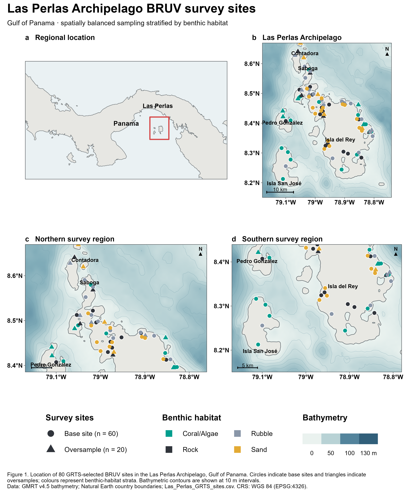

# Las Perlas BRUV Mapping and Spatial Analysis

Publication-quality study-site mapping for a baited remote underwater video (BRUV) survey of the Las Perlas Archipelago, Gulf of Panama.

This repository contains the **QGIS and spatial-analysis component** of the project. The accompanying R workflow for BRUV data preparation, negative-binomial modelling and statistical figures is available in [las-perlas-bruv-analysis](https://github.com/kylealibz/las-perlas-bruv-analysis).

> **Data availability:** The BRUV survey data and site-location data are owned by MarAlliance and are not included in this repository. The finalized map is an original cartographic output created by the repository author; it is provided for portfolio and research-communication purposes only. Access to the underlying survey data must be requested directly from MarAlliance and is subject to its data-sharing conditions.

## Final map



The publication layout developed through this workflow contains:

- a regional locator showing the study area within Panama;
- a complete overview of the Las Perlas Archipelago;
- enlarged northern and southern survey panels;
- 60 base sites and 20 ordered oversample sites;
- habitat-specific site colours for coral/algae, rock, rubble and sand;
- smoothed GMRT bathymetry and 10 m depth contours;
- coastlines, island labels, coordinate annotations, scale bars and north arrows; and
- a publication-ready legend, caption, data attribution and CRS statement.

The figure is distributed as a rendered image only. No source survey table, coordinate file or extractable spatial layer is included.

## Repository structure

```text
las-perlas-qgis-mapping/
├── README.md
├── LICENSE
├── .gitignore
├── qgis/
│   └── Las_Perlas_BRUV_Publication_Map.qgz
├── scripts/
│   ├── prepare_spatial_data.py
│   └── build_publication_qgis_map.py
├── data/
│   └── README.md
├── styles/
│   ├── Las_Perlas_clean_bathymetry.qml
│   └── Las_Perlas_bathymetry_contours_10m.qml
└── outputs/
    └── Figure_1_Las_Perlas_study_site_map.png
```

## Software

- QGIS 3.44 LTR or a compatible QGIS 3 release
- Python supplied with QGIS
- GDAL supplied with QGIS
- R is not required for the mapping workflow in this repository

## Spatial reference system

All survey and layout data use:

```text
WGS 84 (EPSG:4326)
```

Survey locations were supplied as longitude and latitude, and geographic coordinates are displayed around the detailed map panels.

## Data sources

### Survey sites

The spatially balanced candidate-site dataset was supplied by MarAlliance and is not distributed in this repository. The design consists of 15 base sites and five oversamples within each of four habitat strata:

- coral/algae;
- rock;
- rubble; and
- sand.

### Bathymetry

Bathymetry was obtained from the Global Multi-Resolution Topography (GMRT) synthesis. Source and derived spatial data are not distributed in this repository. See [`data/README.md`](data/README.md) for the data-availability statement and preparation details.

### Regional boundaries

Natural Earth country boundaries were used for the regional locator map.

## QGIS workflow

### 1. Import survey sites

The CSV is added as a delimited-text point layer using:

```text
X field: lon
Y field: lat
CRS: EPSG:4326
```

### 2. Symbolize the sampling design

Rule-based symbology communicates two variables simultaneously:

- **shape**: circles are base sites and triangles are oversamples;
- **colour**: teal is coral/algae, charcoal is rock, blue-grey is rubble and gold is sand.

White symbol outlines maintain contrast against bathymetry and coastlines.

### 3. Prepare bathymetry

The source GMRT raster is processed so that:

- negative values are retained as seabed depth;
- positive elevations are removed from the ocean raster;
- cubic resampling reduces blocky display artefacts;
- land is represented by a separate pale-grey mask; and
- the zero-metre elevation contour becomes the coastline.

The bathymetry is displayed with a continuous blue colour ramp from pale shallow water to darker deep water.

### 4. Generate contours

Depth contours are generated at 10 m intervals. They are drawn as thin, semi-transparent blue-grey lines so that they provide environmental context without competing with the survey sites.

### 5. Build the print layout

The PyQGIS script builds a four-panel layout:

| Panel | Contents | Approximate extent |
|---|---|---|
| a | Regional location in Panama | 83.2–76.8°W, 6.8–10.5°N |
| b | Full Las Perlas overview | 79.18–78.74°W, 8.15–8.67°N |
| c | Northern survey region | 79.17–78.76°W, 8.385–8.67°N |
| d | Southern survey region | 79.17–78.78°W, 8.15–8.44°N |

The finished layout includes geographic-coordinate labels, map frames, island names, scale bars, north arrows, panel letters, a manually composed legend and data-source attribution.

## Reproducing the project

1. Clone or download this repository.
2. Obtain authorized access to the MarAlliance survey-site data and download the GMRT bathymetry described in [`data/README.md`](data/README.md).
3. Place the authorized source files locally and run `scripts/prepare_spatial_data.py` from the QGIS Python environment.
4. Open QGIS.
5. Open `qgis/Las_Perlas_BRUV_Publication_Map.qgz` to inspect the data-free project structure, or run `scripts/build_publication_qgis_map.py` from the QGIS Python environment after supplying authorized local data.
6. In QGIS, open **Project → Layouts → Figure 1 - Study site map**.
7. Export the layout at 300–400 dpi as PNG and PDF.

## Cartographic design decisions

- Pale-grey land keeps attention on the marine survey area.
- A restrained blue bathymetric ramp communicates depth without resembling categorical habitat data.
- Colour and shape encode different survey attributes, improving accessibility and interpretation.
- Separate northern and southern panels reduce point overlap.
- Black, enlarged coordinate and legend text remains readable when the figure is placed in a report.
- The regional locator supplies geographic context without cluttering the detailed panels.

## Related analysis

Statistical analysis, data cleaning, model diagnostics and abundance figures are documented separately in:

**[kylealibz/las-perlas-bruv-analysis](https://github.com/kylealibz/las-perlas-bruv-analysis)**

Together, the two repositories document the complete spatial and statistical workflow for investigating how whitetip reef shark MaxN varies with habitat, depth, temperature and survey round.

## Citation

Ryan, W.B.F. *et al.* (2009) ‘Global Multi-Resolution Topography synthesis’, *Geochemistry, Geophysics, Geosystems*, 10, Q03014. https://doi.org/10.1029/2008GC002332

Natural Earth. Free vector and raster map data. https://www.naturalearthdata.com/

